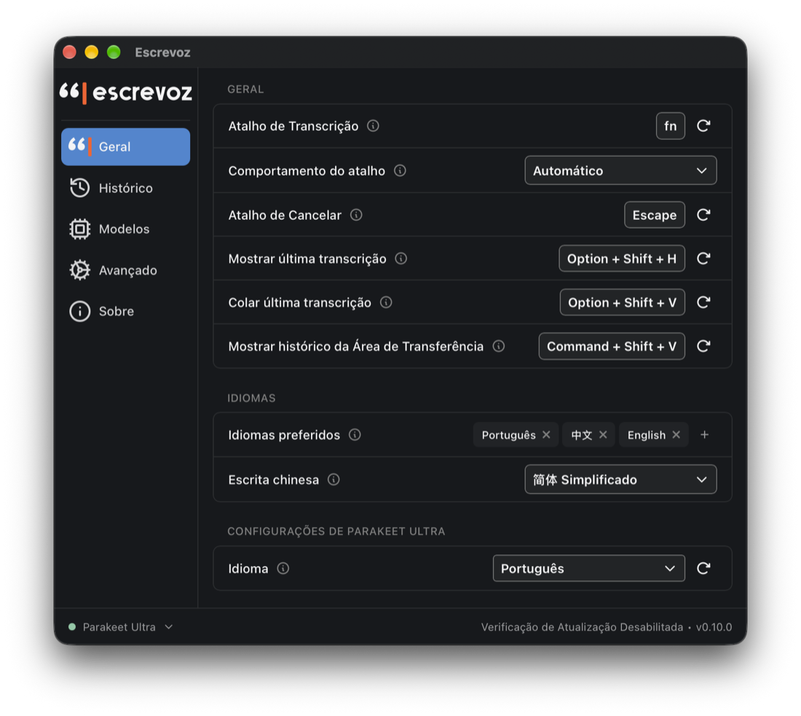
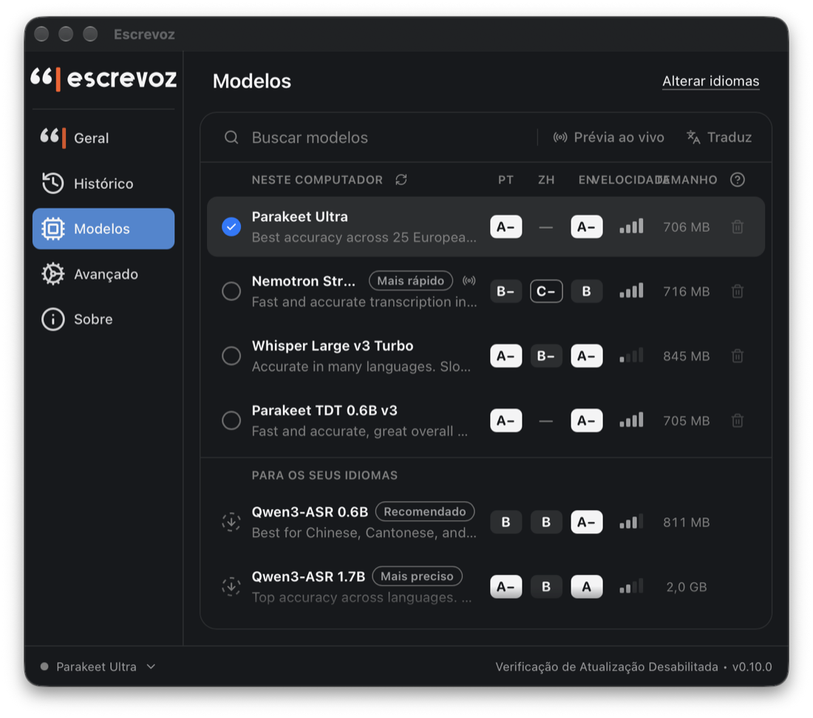
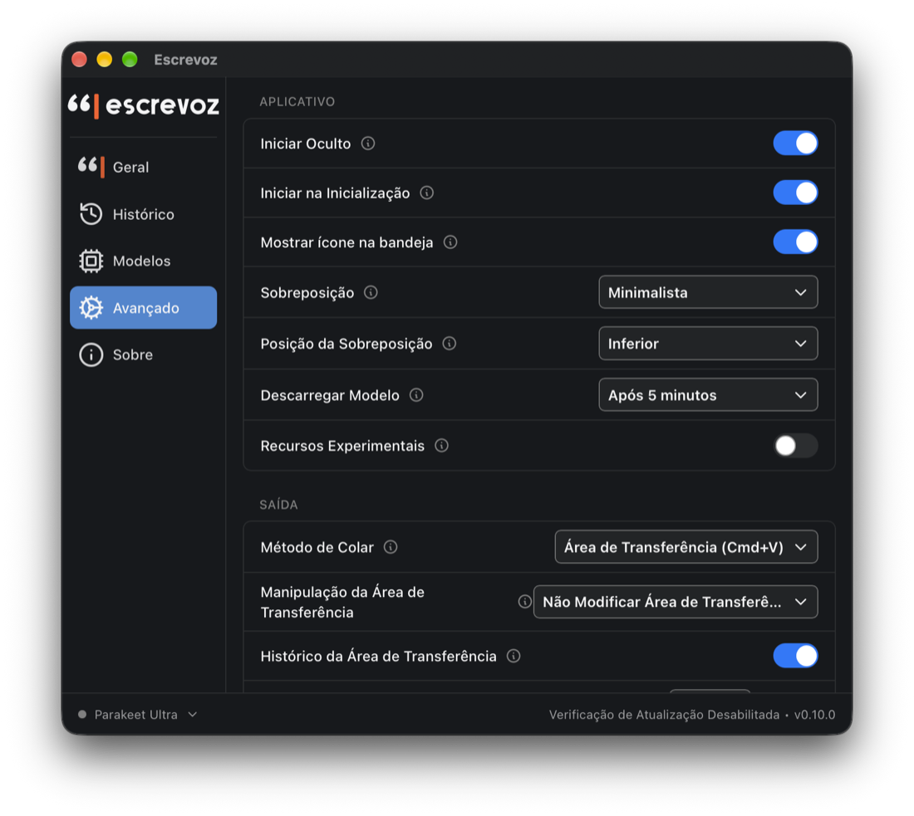

<div align="center">

<picture>
  <source media="(prefers-color-scheme: dark)" srcset="docs/marca/escrevoz-escuro.svg">
  
</picture>

### Ditado por voz para Mac, de graça e sem internet

Aperte um atalho, fale, e o texto aparece onde o cursor estiver, com vírgula e ponto.

<a href="https://github.com/LimaJoota/escrevoz/releases/latest"></a>

[](https://github.com/LimaJoota/escrevoz/stargazers)
[](https://github.com/LimaJoota/escrevoz/releases/latest)
[](LICENSE)


</div>

## Instalar

```bash
brew tap limajoota/escrevoz https://github.com/LimaJoota/escrevoz
brew trust limajoota/escrevoz
brew install --cask escrevoz
```

Ou baixe o [DMG](https://github.com/LimaJoota/escrevoz/releases/latest). Na primeira vez, abra **Ajustes do Sistema › Privacidade e Segurança** e clique em **Abrir Mesmo Assim**. Precisa de um Mac com chip Apple (M1 ou mais novo).

## O que ele faz

- **Sem internet.** A voz vira texto no seu Mac e nenhum áudio sai dele.
- **Nada se perde.** Se o texto não colar, o cartão "Não colou?" guarda o ditado para você colar no lugar certo.
- **Atalhos para tudo.** <kbd>⌥</kbd> <kbd>Espaço</kbd> dita, <kbd>⌥</kbd> <kbd>⇧</kbd> <kbd>V</kbd> cola o último ditado e <kbd>⌘</kbd> <kbd>⇧</kbd> <kbd>V</kbd> abre o histórico do clipboard.
- **Troca exata de palavras.** Ouviu "Jev" quando você disse "dev"? Uma regra resolve.

<table>
  <tr>
    <td></td>
    <td></td>
    <td></td>
  </tr>
  <tr>
    <td align="center"><sub>Atalhos e idiomas</sub></td>
    <td align="center"><sub>Modelos de voz</sub></td>
    <td align="center"><sub>Avançado</sub></td>
  </tr>
</table>

## Gostou?

Deixe uma estrela. Ela ajuda mais gente a achar o Escrevoz.

<a href="https://star-history.com/#LimaJoota/escrevoz&Date">
  <picture>
    <source media="(prefers-color-scheme: dark)" srcset="https://api.star-history.com/svg?repos=LimaJoota/escrevoz&type=Date&theme=dark">
    
  </picture>
</a>

## Créditos

Feito a partir do [Handy](https://github.com/cjpais/Handy), de CJ Pais. Licença [MIT](LICENSE). Para compilar, veja o [BUILD.md](BUILD.md).
